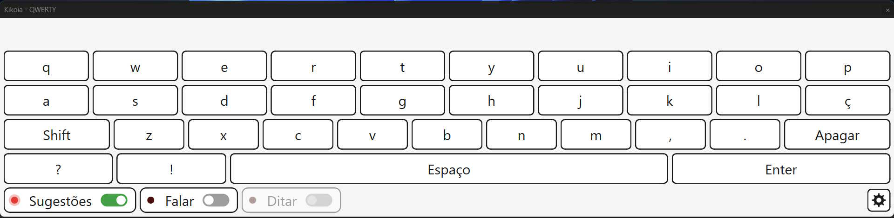
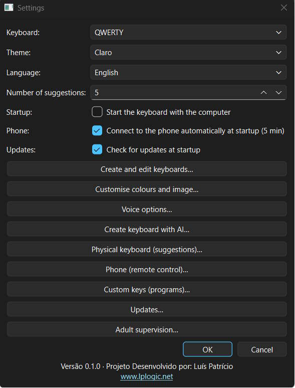
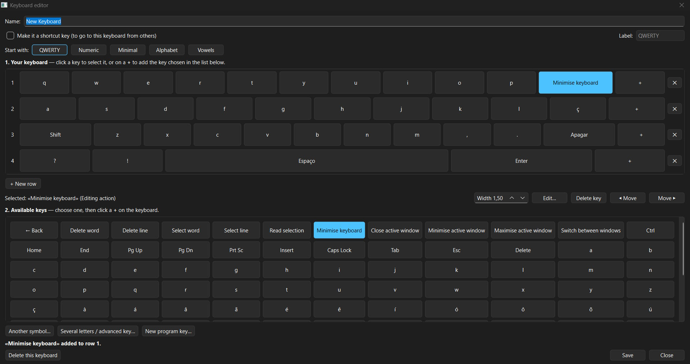
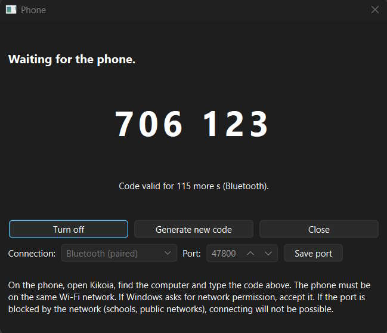
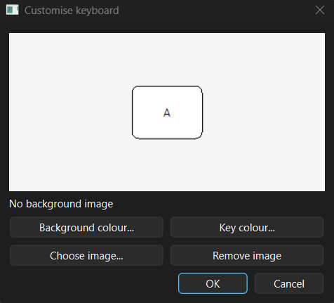
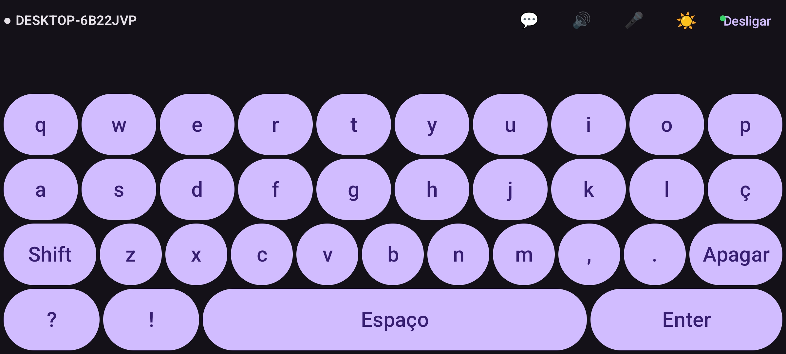
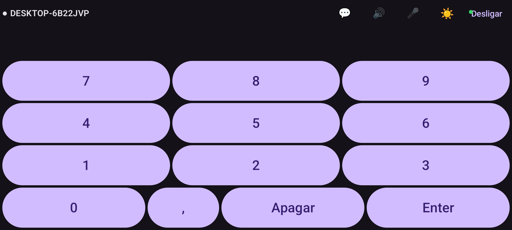
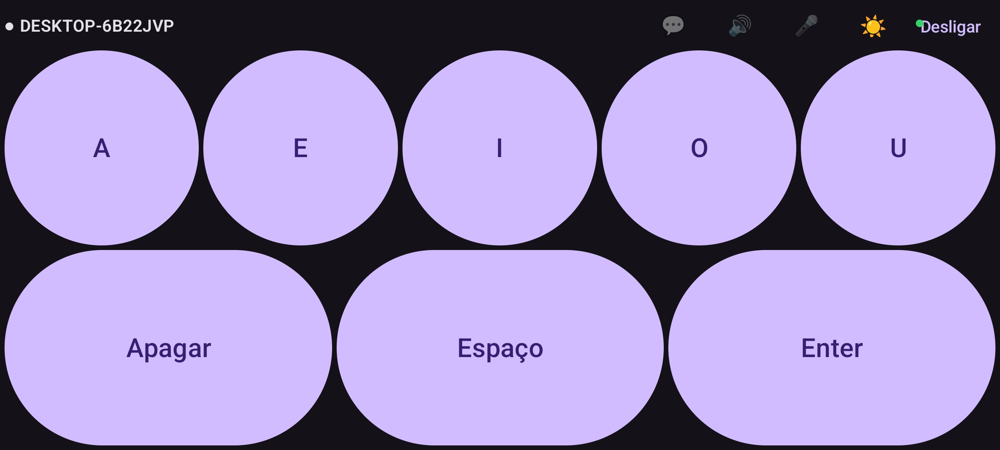

**English** | [Português](README.pt.md)

# Kikoia Project - Adaptive virtual keyboard

Kikoia is an adaptive virtual keyboard that lets you customize the keyboard to each user's needs.
You can set up quick-access keys such as letters with accents or punctuation, action keys, and customize almost every aspect of the keyboard.
The remote keyboard feature turns any Android device into a keyboard for the computer.

In a future update, Kikoia will include an interactive panel for creating and using educational games and other teaching tools.

Fun fact: the name "Kikoia" comes from a 4-year-old child mispronouncing the word "Keyboard".

## Requirements
- Computer running Windows or Linux
- Phone/tablet running Android (only needed for the Remote Keyboard feature)

## Screenshots

### Kikoia Virtual Keyboard

### Kikoia Android App

