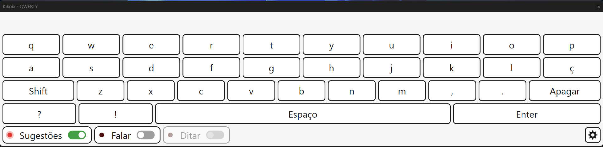
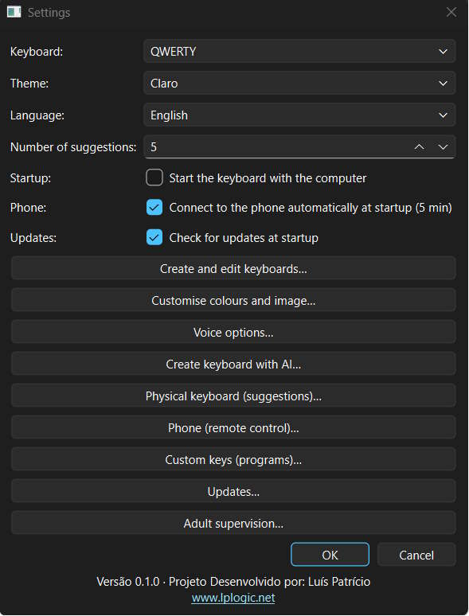
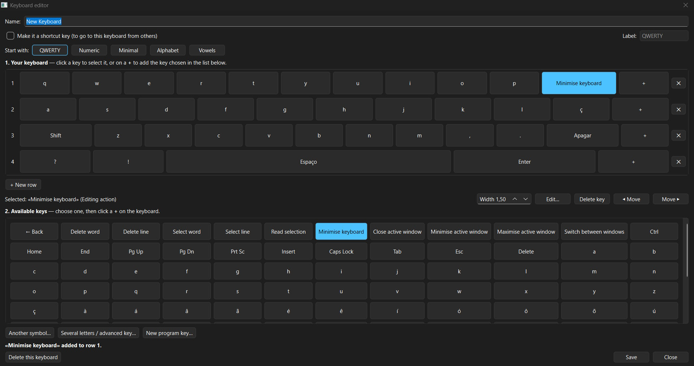
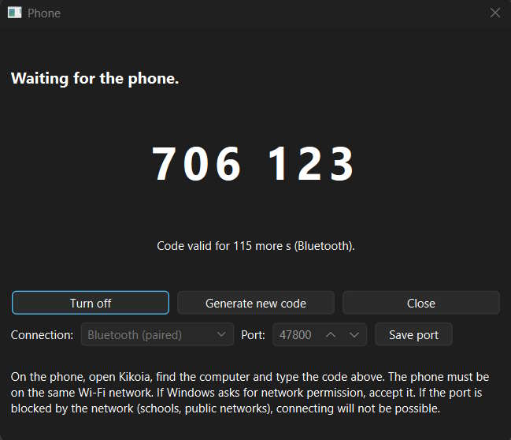
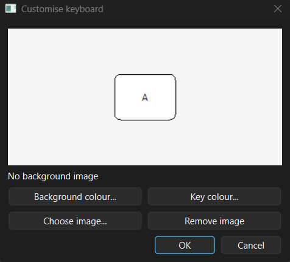
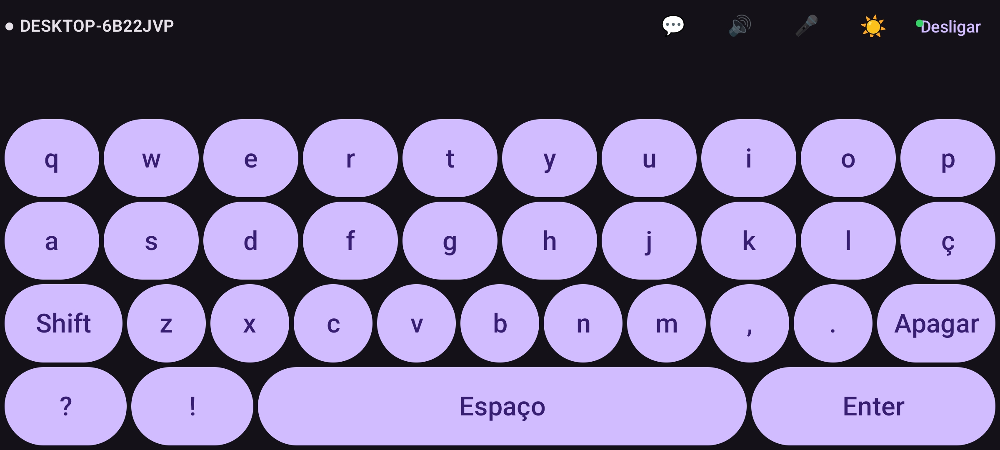
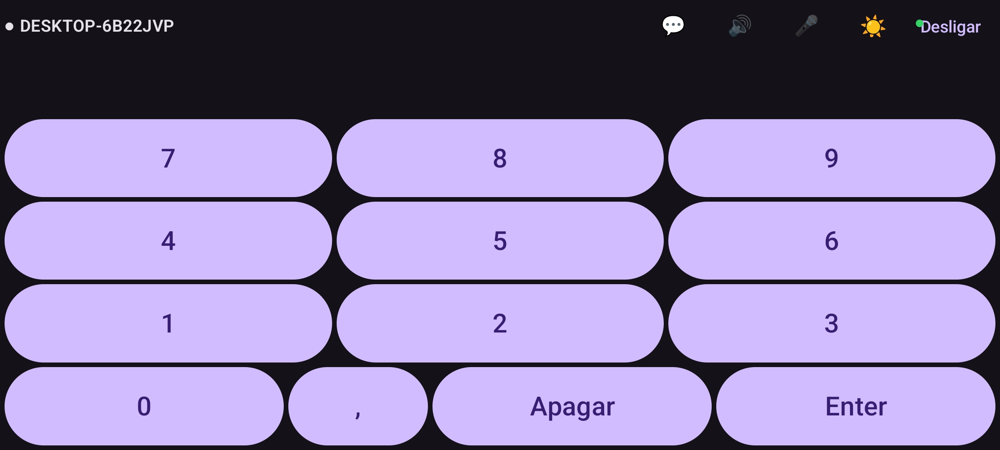
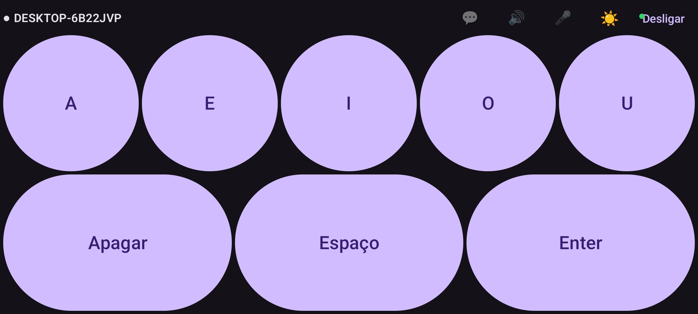

[English](README.md) | **Português**

# Kikoia Project - Teclado virtual adaptativo

O Kikoia é um teclado virtual adaptativo, que permite personalizar o teclado em função das necessidades do utilizador.
Pode configurar teclas de acesso rápido como letras com acentuação ou pontuação, teclas de ação, e personalizar quase todos os aspetos do teclado.
A funcionalidade de teclado remoto permite transformar qualquer dispositivo com sistema operativo Android num teclado para o computador.

Numa atualização futura, o Kikoia contará com um painel interativo, que permite criação e utilização de jogos didáticos e outras ferramentas pedagógicas.

Curiosidade: o nome "Kikoia" vem de uma pronúncia errada da palavra "Keyboard" por uma criança de 4 anos.

## Requisitos
- Computador com sistema operativo Windows ou Linux
- Telemóvel/Tablet com sistema operativo Android (só necessário para a funcionalidade de Teclado Remoto)

## Screenshots

### Teclado Virtual Kikoia

### Aplicação Android Kikoia

